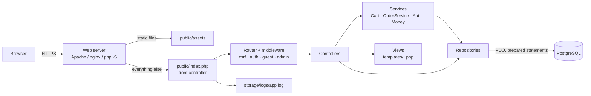
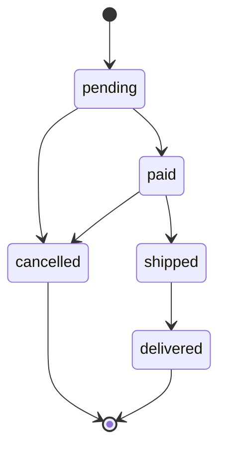
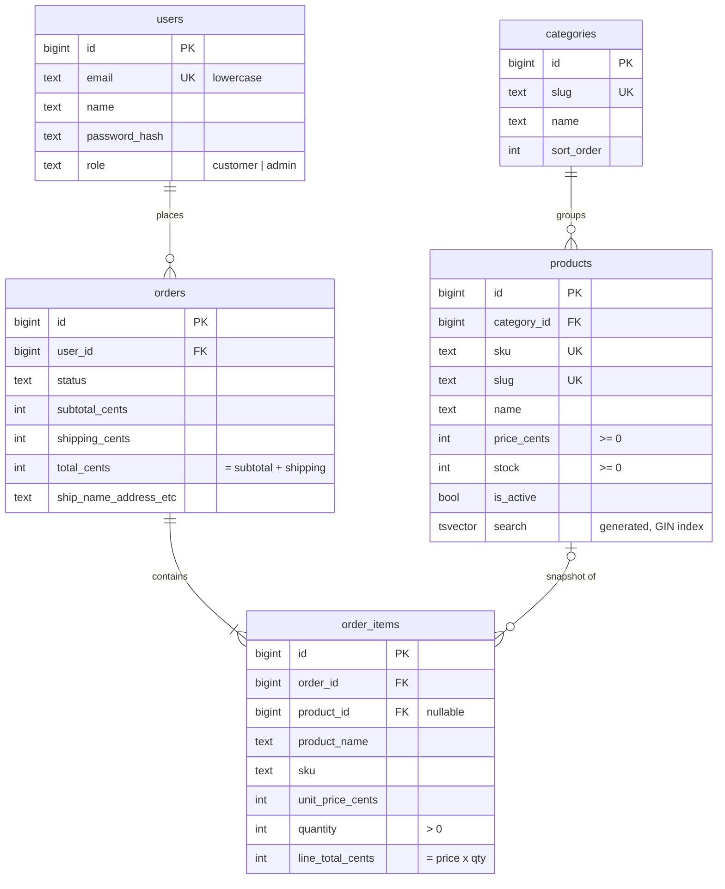
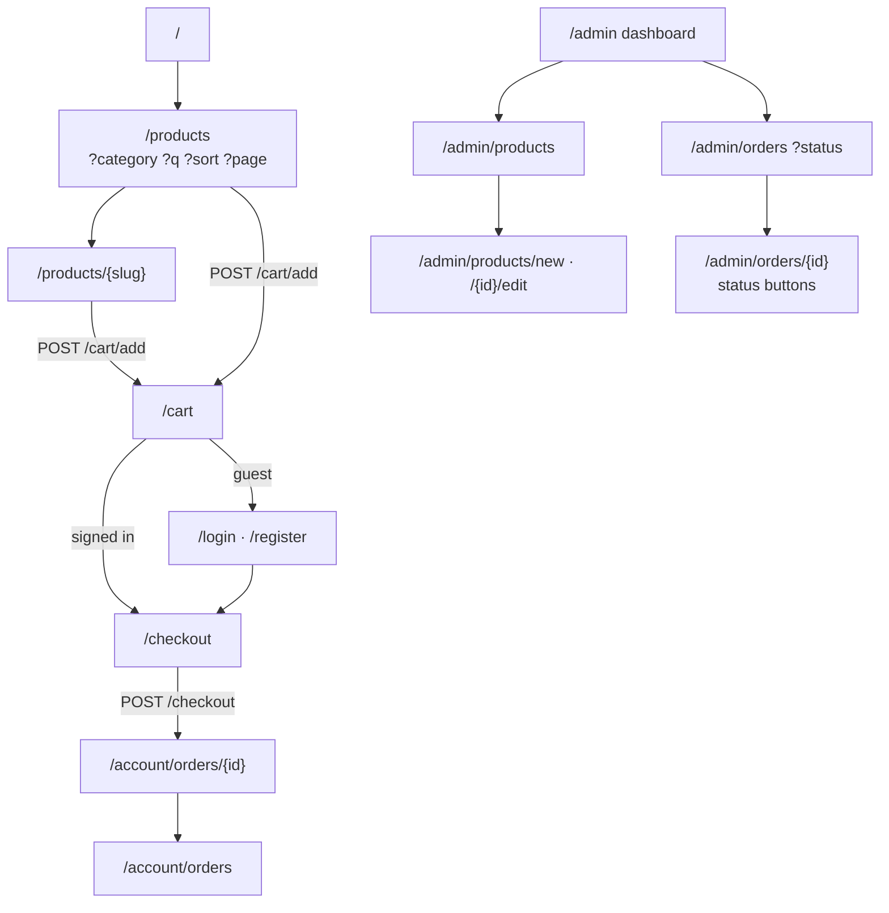

# Bolt & Nut Hardware: Architecture

An online store for small hardware (screws, bolts, anchors, hinges, hand tools), built on plain PHP 8.2+ and PostgreSQL 16. This document covers the system design, the file layout and the UI architecture of the minimal production version, and what to add next.

## 1. Goals and constraints

| Goal | How the design meets it |
| --- | --- |
| Easy to run and audit | No framework and no runtime Composer dependencies. Around 3,500 lines of readable PHP and templates. Composer is only needed for PHPUnit. |
| Correct money and stock | Prices are integer cents. Orders are placed in one transaction that locks product rows, so stock can never go negative or be oversold. |
| Secure by default | Prepared statements everywhere, CSRF on every POST, escaped output, hardened sessions, login throttling, strict CSP. |
| Works on any device | Server-rendered HTML, mobile-first CSS, no JavaScript required. |
| Room to grow | Layered code (controller → service → repository) so payments, email or an API can be added without rewrites. |

## 2. System overview



### Layers

| Layer | Folder | Responsibility | Must not |
| --- | --- | --- | --- |
| Front controller | `public/index.php` | Bootstrap, security headers, dispatch | Contain business logic |
| Core | `src/Core` | Router, Request/Response, View, Session, CSRF, Validator, DB, errors, logging | Know about products or orders |
| Controllers | `src/Controllers` | Read input, validate, call services, pick a template or redirect | Write SQL |
| Services | `src/Services` | Business rules: cart pricing, shipping, order placement, status transitions, auth | Render HTML |
| Repositories | `src/Repositories` | All SQL, one class per aggregate | Hold business rules |
| Views | `templates` | Escaped HTML output | Query the database (except the cart badge in the layout) |

### Request lifecycle

1. The web server sends any request that is not a real file to `public/index.php`.
2. `bootstrap.php` loads the autoloader, `.env` config and the error handler.
3. `App::securityHeaders()` sends the CSP and hardening headers.
4. `App::handle()` starts the session, loads `config/routes.php` and dispatches.
5. The router matches `METHOD + path`, runs `csrf` for every POST, then the route's middleware (`auth`, `guest`, `admin`). Middleware can return a redirect or throw an `HttpException`.
6. The controller returns a `Response`: rendered HTML, or a 303 redirect after every successful POST (Post/Redirect/Get, so refreshing never resubmits a form).
7. `HttpException`s become 403/404/419 pages. Anything else is logged as JSON and shown as a generic 500 page (with a stack trace only when `APP_DEBUG=true`).

### Key flows

**Add to cart.** The session stores only `product_id => quantity`. Every time the cart is shown, `Cart::summary()` re-reads names, prices and stock from the database, drops products that were hidden or sold out, and caps quantities at available stock. Prices cannot be tampered with from the client.

**Checkout.** Sign-in is required. `OrderService::place()` runs in one transaction:

```
BEGIN
  SELECT … FROM products WHERE id IN (…) AND is_active ORDER BY id FOR UPDATE   -- lock rows, fixed order avoids deadlocks
  check stock for every line, compute subtotal and shipping from locked prices
  INSERT orders … RETURNING id
  INSERT order_items (snapshot of name, SKU, unit price)
  UPDATE products SET stock = stock - qty
COMMIT
```

If any line is short, nothing is written and the shopper is sent back to the cart with a clear message. The `CHECK (stock >= 0)` constraint is a second line of defence.

**Order lifecycle.** Status changes go through `OrderService::changeStatus()`, which locks the order row and enforces:



Cancelling returns the items to stock in the same transaction.

**Sign in.** Passwords use `password_hash()` (bcrypt today, rehashed automatically if PHP's default changes). Unknown emails still run a hash so timing does not reveal which accounts exist. Failures are recorded in `login_attempts`; 5 failures per email or 20 per IP within 15 minutes lock sign-in. The session id is regenerated on login, and the guest cart is kept.

## 3. Data model



Also: `login_attempts` (throttling) and `schema_migrations` (applied migration versions).

Design decisions:

- **Integer cents with CHECK constraints** so totals are exact and the database itself rejects inconsistent orders.
- **Order items are snapshots.** Editing or deleting a product never changes a past order. `product_id` becomes `NULL` if a product is ever hard-deleted; the admin UI only hard-deletes products that were never ordered and hides the rest.
- **Search** uses a generated `tsvector` column (name and SKU weighted above description) with a GIN index, plus `ILIKE` for partial tokens like "m8".
- **`updated_at` triggers** keep audit timestamps honest regardless of which code path writes.
- **Partial index** on `products(category_id) WHERE is_active` matches the storefront's hottest query.

Migrations are plain SQL files in `database/migrations`, applied in filename order by `bin/migrate.php`, each in its own transaction (PostgreSQL has transactional DDL, so a failed migration leaves no half-applied schema).

## 4. File structure

```
.
├── bootstrap.php                 Autoloader, .env, error handler (shared by web and CLI)
├── composer.json                 PSR-4 autoload; PHPUnit as the only dev dependency
├── config/
│   └── routes.php                Every URL, its controller action and middleware
├── public/                       Web server document root (nothing else is web-reachable)
│   ├── index.php                 Front controller
│   ├── .htaccess                 Apache rewrite to the front controller
│   └── assets/
│       ├── css/app.css           Design tokens, layout, components, light/dark themes
│       └── js/app.js             Progressive enhancement (confirm, double-submit guard, auto-sort)
├── src/
│   ├── helpers.php               Template helpers: e(), money(), csrf_field(), old(), url(), asset()
│   ├── Core/                     Framework-agnostic plumbing
│   │   ├── App.php               Middleware registration, error pages, security headers
│   │   ├── Router.php            Pattern routes with {params}, per-route middleware, CSRF on POST
│   │   ├── Request.php / Response.php / HttpException.php
│   │   ├── View.php              Template + layout rendering with output buffering
│   │   ├── Session.php           Hardened cookies, flash messages, old input
│   │   ├── Csrf.php              Per-session synchronizer token
│   │   ├── Validator.php         Rule strings: required|email|max:255|money|slug|…
│   │   ├── Database.php          PDO connection and transaction helper
│   │   ├── Config.php            .env loader (real env vars win)
│   │   ├── ErrorHandler.php      Errors → exceptions → log + safe 500 page
│   │   └── Logger.php            JSON lines to storage/logs/app.log
│   ├── Controllers/
│   │   ├── Controller.php        Base: view(), redirect(), backWithErrors(), paging
│   │   ├── HomeController.php
│   │   ├── CatalogController.php Listing, filtering, search, product page
│   │   ├── CartController.php
│   │   ├── CheckoutController.php
│   │   ├── AccountController.php Customer order history
│   │   ├── AuthController.php    Register, sign in, sign out
│   │   └── Admin/                Dashboard, ProductController (CRUD), OrderController (status)
│   ├── Services/
│   │   ├── Auth.php              Current user, login, throttling
│   │   ├── Cart.php              Session cart resolved against live catalog data; shipping rule
│   │   ├── OrderService.php      Transactional order placement and status machine
│   │   └── Money.php             Cents parsing and formatting without floats
│   └── Repositories/             UserRepository, CategoryRepository, ProductRepository, OrderRepository
├── templates/                    See section 5
├── database/
│   ├── migrations/001_initial_schema.sql
│   └── seeds/catalog.sql         6 categories, 24 products (idempotent)
├── bin/
│   ├── migrate.php               Apply pending migrations (--status to list)
│   ├── seed.php                  Load demo catalog and the initial admin
│   └── create-admin.php          Create or promote an admin, password read from the terminal
├── tests/
│   ├── Unit/                     Money, Validator, Router
│   ├── Integration/              OrderService against a real PostgreSQL test database
│   └── smoke.sh                  18-step end-to-end check over HTTP with curl
├── docker/php.ini, Dockerfile, docker-compose.yml
├── storage/logs/                 Application log (git-ignored)
└── docs/ARCHITECTURE.md          This document
```

## 5. UI architecture

### Rendering model

Server-rendered HTML with plain PHP templates. Each page template renders into a layout; repeated pieces are partials. All dynamic output goes through `e()` (HTML escaping); the only raw output is other rendered templates.

```
templates/
├── layouts/
│   ├── main.php        Storefront shell: header (logo, search, nav, cart badge), flash area, footer
│   ├── admin.php       Back-office shell: sidebar nav (top bar on phones), noindex
│   └── minimal.php     Error shell with no database or session dependencies
├── partials/
│   ├── product-card    Image, name, category, SKU, price, add-to-cart or out-of-stock
│   ├── product-image   Real image or a category glyph placeholder
│   ├── field           Labelled input with hint, inline error and aria-invalid/aria-describedby
│   ├── order-summary   Subtotal / shipping / total
│   ├── order-detail    Line items and address (shared by customer and admin)
│   ├── status-badge, pagination, flash
├── home/index          Hero, category tiles, newest products
├── catalog/index       Category filter, sort, results grid, pagination
├── catalog/show        Breadcrumbs, product detail, quantity, related products
├── cart/show           Editable cart table, summary card
├── checkout/show       Shipping form, order summary, place order
├── account/orders, account/order
├── auth/login, auth/register
├── admin/dashboard, admin/products/{index,form}, admin/orders/{index,show}
└── errors/403, 404, 500, generic
```

### Page map



### Interaction patterns

- **Post/Redirect/Get** for every form. Success and error messages are one-shot flash messages; invalid forms redirect back with the user's input and per-field errors.
- **Progressive enhancement.** `app.js` only adds: confirm dialogs on destructive forms (`data-confirm`), a double-submit guard on "Place order" (`data-once`), and auto-submit on the sort dropdown (with a `<noscript>` button). With JavaScript off everything still works.
- **Stock feedback** on cards and product pages: in stock, "Only N left", or out of stock (add-to-cart hidden).

### Visual system

- Design tokens as CSS custom properties on `:root` (surface, text, muted, border, accent, status colours, radius, shadow), redefined under `prefers-color-scheme: dark`.
- Safety-orange accent on a warm neutral palette, system font stack, no web fonts or external assets (CSP-friendly, fast).
- Mobile first: single column on phones, 2-column product grid from 320 px, sidebar layouts from 860–900 px. Tables collapse into labelled rows below 640 px using `data-label`.

### Accessibility

Skip link, landmark elements, `aria-current` on active navigation, labels on every input, `aria-invalid` + `aria-describedby` for errors, `role="alert"` on error flashes, visible focus rings, 44 px touch targets, and colour never used alone for status (badges carry text).

## 6. Security

| Threat | Mitigation |
| --- | --- |
| SQL injection | PDO with native prepared statements (`ATTR_EMULATE_PREPARES=false`); dynamic `ORDER BY` only from a whitelist |
| XSS | `e()` on all output; CSP `default-src 'self'` with no inline scripts; `nosniff` |
| CSRF | Per-session token checked by the router on every POST; `SameSite=Lax` cookies |
| Session fixation / theft | `use_strict_mode`, `HttpOnly`, `Secure` when `APP_URL` is https, id regenerated on login, destroyed on logout |
| Credential stuffing | Throttling per email and per IP; generic "email or password is incorrect" message; constant-time-ish lookup |
| Price tampering | Prices never come from the client; recomputed from locked rows at checkout |
| Overselling | Row locks + `CHECK (stock >= 0)` |
| IDOR on orders | Customer order pages check ownership and return 404 for other users' orders |
| Clickjacking | `frame-ancestors 'none'` and `X-Frame-Options: DENY` |
| Open redirect | Post-login redirect only accepts same-site paths |
| Information leaks | `display_errors` off outside debug, stack traces only in logs, `expose_php=Off` |

## 7. Operations

- **Configuration** via environment variables or `.env` (see `.env.example`). Real environment variables override the file.
- **Deploy**: build the Docker image (or any PHP 8.2+ host with `pdo_pgsql`), point the document root at `public/`, run `php bin/migrate.php` on each release, then switch traffic. Set `APP_ENV=production`, `APP_DEBUG=false` and an `https://` `APP_URL`.
- **Logs**: JSON lines in `storage/logs/app.log` (or the PHP error log if not writable), easy to ship to any log aggregator.
- **Backups**: standard `pg_dump` / managed-Postgres snapshots; all state lives in PostgreSQL apart from sessions.
- **Scaling**: the app is stateless except PHP sessions. To run several web nodes, move sessions to Redis or a `sessions` table, put assets behind a CDN, and add a read replica if catalog traffic grows.

## 8. Deliberately out of scope for the minimal version, and the next steps

1. **Online payments.** Orders are created as `pending` ("pay on delivery / bank transfer"). Next: a Stripe Checkout or PaymentIntent integration that moves orders to `paid` from a verified webhook.
2. **Transactional email** (order confirmation, password reset) through a queue table and a worker.
3. **Password reset** and email verification.
4. **Product image uploads** to object storage (today the admin enters an image URL).
5. **Category management UI** (categories are seeded via SQL today).
6. **Guest checkout**, saved addresses, VAT/tax rules per country.
7. **CI** running `composer test` and `tests/smoke.sh` against a PostgreSQL service container.
